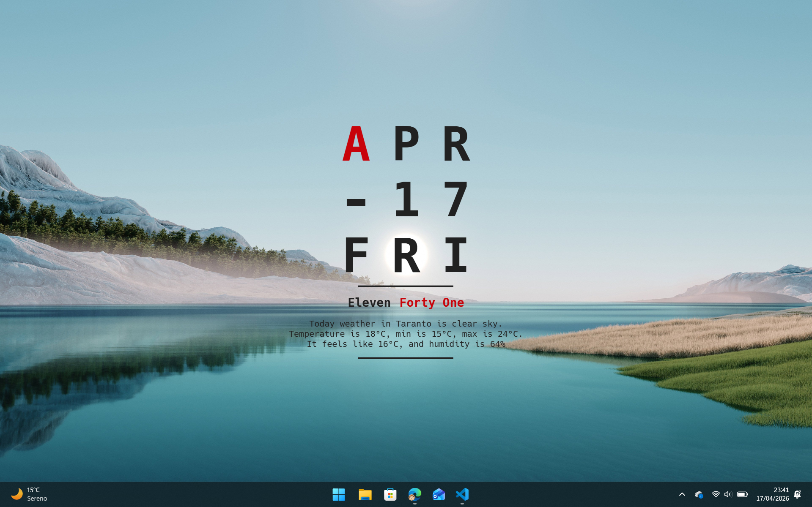

# vitrine-alnitak

A theme for [Vitrine](https://github.com/felixstrobel/vitrine), inspired by [Mond](https://visualskins.com/skin/mond), a theme for [Rainmeter](https://www.rainmeter.net/).



## Features

- Date displayed as a 3×3 letter grid ([Hack](https://sourcefoundry.org/hack/) font)
- Time displayed as English words (e.g. *Three* **Forty-Two**)
- Configurable accent color
- Optional weather conditions via [Open-Meteo](https://open-meteo.com/) (no API key required)
- Dark and light theme

## Settings

| Setting | Type | Default | Description |
|---|---|---|---|
| `theme` | string | `dark` | Color scheme — `dark` or `light` |
| `accentColor` | string | `#448AFF` | Accent color for the first date letter and the minutes |
| `showWeather` | boolean | `false` | Show current weather conditions |
| `weatherCity` | string | — | City used to fetch weather data |
| `temperatureUnit` | string | `celsius` | `celsius` or `fahrenheit` |

## Build

```sh
make install   # install dependencies (runs inside Docker, Node 20)
make build     # produce dist/ (runs inside Docker, Node 20)
```

Requires Docker.
