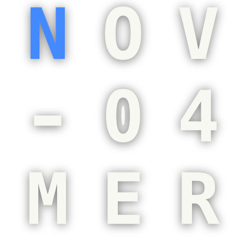

# Alnitak for Vitrine

Monospaced widgets for [Vitrine](https://github.com/vitrine-org/vitrine) in
[Hack](https://sourcefoundry.org/hack/): the date as a 3×3 grid of letters, the time in words with
the minutes in the accent color, and the weather in three centered lines, drawn straight on your
wallpaper.

| Widget | Size | |
|---|---|---|
| **Date grid**: month, day and weekday, the first letter in the accent color | 2×2 to 6×6 |  |
| **Word clock**: “Eleven Forty One” under a thin rule | 3×1 to 8×2 |  |
| **Weather**: today's conditions, low, high and feels-like from [Open-Meteo](https://open-meteo.com), works offline from cache | 5×1 to 10×3 |  |

Every widget has light or dark text, an accent color (or the Windows one), a soft text shadow and
an optional acrylic card for busy wallpapers.

## Install

Download `alnitak-2.0.0.vitrine` from the [latest release](https://github.com/vitrine-org/alnitak/releases/latest)
and double-click it. Vitrine adds the widgets to its gallery.

The Vitrine 1 theme lives on the [`v1`](https://github.com/vitrine-org/alnitak/tree/v1) branch.

## Build

```sh
npm install
npm run pack      # → alnitak-2.0.0.vitrine
```

`package.json` points `@vitrine/sdk` at `file:../../vitrine-sdk` for local builds; releases use
`github:vitrine-org/sdk#v2.0.0`. Preview a widget with
`vitrine render dist date --cells 3x3 --scale 2 --out date.png`.

## License

MIT. Hack is bundled under its own MIT and Bitstream Vera licenses (see `LICENSE`).
